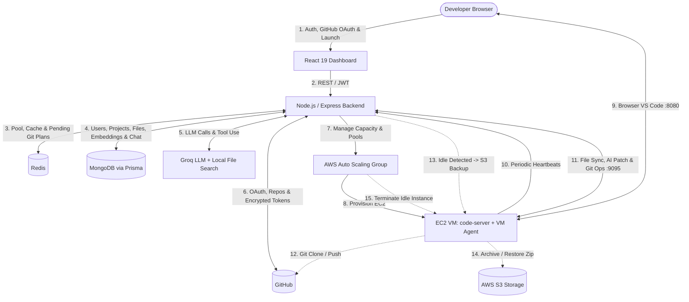

# Kanvas 🎨

[](https://kanvas.advertises.co.in)
[](https://www.typescriptlang.org/)
[](https://react.dev/)
[](https://nodejs.org/)
[](https://aws.amazon.com/)
[](https://redis.io/)
[](https://www.prisma.io/)
[](https://www.mongodb.com/)
[](https://www.docker.com/)

🔗 **Live Application URL**: [https://kanvas.advertises.co.in](https://kanvas.advertises.co.in)

**Kanvas** is a cloud IDE and AI coding platform (similar to Replit, GitHub Codespaces, and Cursor). It runs full browser-based VS Code environments on **AWS EC2 and ASG (Auto Scaling Group)**—complete with an AI Agent that connects to your GitHub repositories, edits code using semantic file search and chat history summarization, and commits & pushes changes after your confirmation.

---

## 🖥️ Preview


---

## ✨ Key Features

- 🤖 **AI Agent & GitHub Integration**: Connect your GitHub account via OAuth, pick an existing repo or create a new public/private repo from Kanvas, and let the AI Agent write code, commit, and push to branches.
- 🔐 **Confirmed Git Push**: When the AI wants to push code (`git_push` tool), Kanvas saves the push plan in Redis and asks you to reply `yes` or `no` before committing and pushing to GitHub.
- 🧠 **AI Assistant with File Search & Chat Summary**: Uses Groq LLM (`openai/gpt-oss-120b` with `openai/gpt-oss-20b` fallback), local embeddings (`Xenova/bge-small-en-v1.5`) to find relevant files, and summarizes older chat messages (when > 4 messages) so the AI remembers what was already built.
- ⚡ **Fast Workspace Startup**: Keeps pre-warmed EC2 instances ready in an AWS ASG so you get a working VS Code environment in seconds.
- 💰 **Auto-Shutdown for Idle Workspaces**: A background job checks heartbeats in Redis; if a workspace is idle, it backs up the files and terminates the EC2 instance to save AWS costs.
- 💾 **S3 Backup & Restore**: Idle workspaces are zipped and uploaded to AWS S3, then downloaded and unzipped onto a new EC2 instance when you reopen the project.
- 📁 **In-VM File Sync Agent**: A small Node.js service inside each EC2 instance (port `9095`) uses Chokidar to watch file changes, sync them to MongoDB, run Git commands, and handle S3 backup/restore.
- 🚀 **Multiple Environments**: Supports **AI Agent (GitHub)**, **AI Projects**, **Node.js**, **React (Vite + TypeScript)**, **Python 3**, and **Java 17 (OpenJDK)**.
- 🔒 **Auth & Encrypted Tokens**: Google OAuth 2.0, JWT with refresh-token rotation and Redis blacklisting, plus AES-256-GCM encryption for stored GitHub OAuth tokens.

---

## 🚀 Why Kanvas Stands Out

### 1. 💡 Auto-Scaling with Heartbeats & S3 Backup

Running cloud IDEs on AWS gets expensive fast if users leave tabs open or forget to shut down their machines.

Kanvas handles this automatically:

1. **Heartbeats**: While your workspace is open, the browser pings `/heartBeat/:instanceId`.
2. **Idle Check**: A background job checks active instances (`ALL_MACHINES`) in Redis.
3. **S3 Backup**: If no heartbeat arrives within `GRACE_PERIOD`, the backend calls `/store-project` on the VM agent to zip `/tmp/kanvas` and upload it to AWS S3.
4. **ASG Scale-In**: The backend terminates the idle EC2 instance and lowers the ASG desired capacity.
5. **Restore**: When you reopen the project later, Kanvas grabs a warm instance from the pool and calls `/restore-project` to unzip your files from S3.

> [!IMPORTANT]
> **Cost Saving**: You only pay for EC2 while you're actually using it. Idle workspaces are backed up to S3 and shut down automatically.

### 2. 🤖 GitHub-Connected AI Agent

Instead of starting from scratch on every prompt, Kanvas indexes your project files locally with `Xenova/bge-small-en-v1.5` embeddings, sends only the most relevant files to the LLM, summarizes older chat messages after 4 turns, writes AI changes straight to your live EC2 VS Code folder, and pushes to GitHub branches when you confirm.

---

## 🏗️ Architecture

Kanvas has four main parts:



### Component Breakdown

1. **Frontend (`/Frontend/ReplitFrontend`)**: React 19, Vite, TypeScript, TailwindCSS, React Router DOM, React Hook Form, React Markdown + Syntax Highlighter, Google OAuth2, and GitHub Repo Selector.
2. **Backend (`/Backend`)**: Express 5, TypeScript, AWS SDK v3 (EC2 & Auto Scaling), Prisma ORM with MongoDB, Redis (`ioredis`), Groq SDK, `@xenova/transformers` (local embeddings), and GitHub OAuth + AES-256-GCM token encryption.
3. **In-VM Agent (`/VS-Dummy-Ins`)**: Node.js/Express service running inside each EC2 instance on port `9095` with Chokidar file-watcher, Git CLI routes (`/git-clone`, `/git-push`), AI file writer (`/update-files`), and AWS S3 backup/restore (`/store-project`, `/restore-project`).
4. **Cloud IDE Image (`/code-server`)**: Dockerized `codercom/code-server:4.96.4` with Node.js 22, Python 3, Java 17 (OpenJDK), and Git configured for `/tmp/kanvas`.

---

## 🛠️ Tech Stack

| Domain              | Technologies                                                                 |
| :------------------ | :--------------------------------------------------------------------------- |
| **Frontend**        | React 19, Vite, TypeScript, TailwindCSS, React Router DOM, React Hook Form   |
| **Backend**         | Node.js, Express 5, TypeScript, Prisma ORM, MongoDB                          |
| **Cloud & DevOps**  | AWS EC2, AWS ASG, AWS S3, AWS SDK v3, Docker                                 |
| **Caching & State** | Redis (`ioredis`)                                                            |
| **AI & File Search**| Groq SDK (`openai/gpt-oss-120b` / `20b`), `@xenova/transformers`, Cosine Sim |
| **GitHub & Agent**  | GitHub OAuth, AES-256-GCM Token Encryption, Git CLI, `git_push` Tool         |
| **Authentication**  | JWT, Refresh Token Rotation, Redis Blacklisting, Google OAuth 2.0            |
| **IDE**             | `code-server` (VS Code in the browser), Chokidar                             |

---

## ⚙️ Configuration & Environment Variables

### Backend Configurations (`Backend/.env`)

```env
PORT=9092
SECRET_KEY=your_jwt_secret_key
DATABASE_URL=mongodb+srv://...  # MongoDB connection string
FRONTEND_URL=https://kanvas.advertises.co.in

# AWS Configuration
ACC_KEY_ID=your_aws_access_key_id
SECRET_ACC_KEY=your_aws_secret_access_key
AUTO_SCALING_GROUP_NAME=your_aws_asg_name

# Redis Configuration
REDIS_HOST=redis
REDIS_PORT=6379

# Heartbeat Timeout
GRACE_PERIOD=300000             # Milliseconds before terminating idle VMs (e.g. 5 minutes)

# AI Engine
GROQ_KEY=your_groq_api_key

# Google OAuth
GOOGLE_CLIENT_ID=your_google_oauth_client_id
GOOGLE_SECRET=your_google_oauth_client_secret

# GitHub Agent OAuth & Token Encryption
AGENT_GITHUB_CLIENT_ID=your_github_oauth_client_id
AGENT_GITHUB_CLIENT_SECRET=your_github_oauth_client_secret
AGENT_GITHUB_CALLBACK_URL=https://kanvas.advertises.co.in/api/auth/github/callback
TOKEN_ENC_KEY=your_64_char_hex_aes256_key  # openssl rand -hex 32
```

### Frontend Configurations (`Frontend/ReplitFrontend/.env`)

```env
VITE_BACKEND_URL=https://kanvas.advertises.co.in/api
VITE_GOOGLE_CLIENT_ID=your_google_oauth_client_id
VITE_GOOGLE_SECRET=your_google_oauth_client_secret
```

### VM Agent Configurations (`VS-Dummy-Ins/.env`)

```env
PORT=9095
BUCKET_NAME=kanvas-staleproject-data
ACC_KEY_ID=your_aws_access_key_id
SECRET_ACC_KEY=your_aws_secret_access_key
WORKSPACE_DIR=/tmp/kanvas
GIT_AUTHOR_NAME=Kanvas
GIT_AUTHOR_EMAIL=noreply@kanvas.advertises.co.in
```

---

## 🚀 Setup & Local Installation

### Prerequisites

- **Node.js** (v18+) & **npm**
- **Docker** & **Redis**
- **MongoDB** instance (Atlas or local)
- **AWS Account** configured with an Auto Scaling Group and S3 bucket
- **Groq API Key** & **GitHub OAuth App** (for AI & AI Agent features)

### 1. Database Setup (Prisma)

```bash
cd Backend
npm install
npx prisma generate
```

### 2. Running Redis

```bash
docker run -d --name redis -p 6379:6379 redis:alpine
```

### 3. Running the Backend

```bash
cd Backend
npm run dev
```

The server will boot on port `9092`, build TypeScript (`dist/`), and sync with Redis and the AWS Auto Scaling Group.

### 4. Running the Frontend

```bash
cd Frontend/ReplitFrontend
npm install
npm run dev
```

Open your browser to `http://localhost:5174`.

---

## 📦 Containerization & Deployment

### 1. Build & Run Backend

```bash
cd Backend
docker build -t kanvas-backend .
docker run -p 9092:9092 --env-file .env kanvas-backend
```

### 2. Build & Run Frontend

```bash
cd Frontend/ReplitFrontend
docker build -t kanvas-frontend .
docker run -p 80:80 kanvas-frontend
```

### 3. Build & Run VM Agent

```bash
cd VS-Dummy-Ins
docker build -t kanvas-agent .
docker run -p 9095:9095 --env-file .env kanvas-agent
```

---

## 👥 Authors & Contributors

- **Brijesh** ([@Brijesh-0106](https://github.com/Brijesh-0106))
