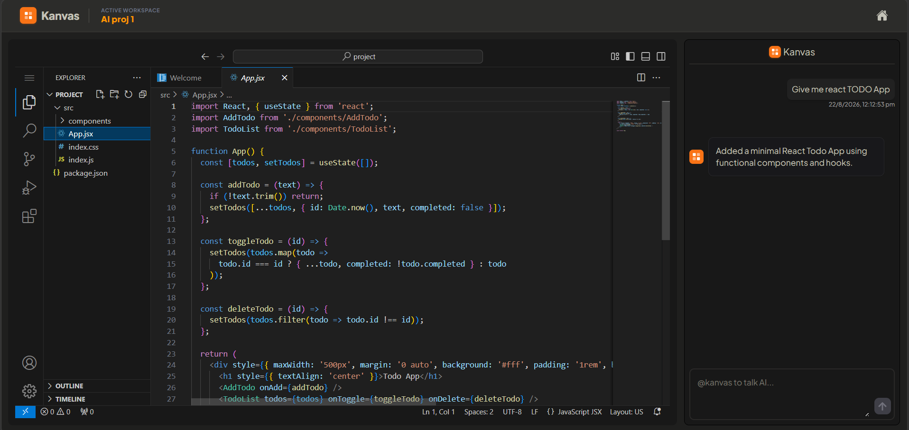
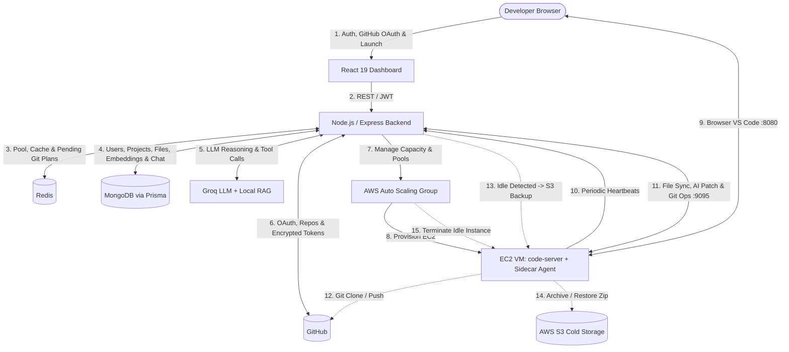

# Kanvas 🎨

[](https://kanvas.advertises.co.in)
[](https://www.typescriptlang.org/)
[](https://react.dev/)
[](https://nodejs.org/)
[](https://aws.amazon.com/)
[](https://redis.io/)
[](https://www.prisma.io/)
[](https://www.mongodb.com/)
[](https://www.docker.com/)

🔗 **Live Application URL**: [https://kanvas.advertises.co.in](https://kanvas.advertises.co.in)

**Kanvas** is a high-performance, cost-optimized cloud development environment and AI coding platform (similar to Replit, GitHub Codespaces, and Cursor/Bolt). It provisions, lifecycle-manages, and orchestrates full browser-based VS Code environments on-demand in AWS EC2—complete with an **AI Agent** that connects to your GitHub repositories, edits code via semantic RAG search and rolling conversation memory, and commits & pushes changes with confirmation.

---

## 🖥️ Preview



---

## ✨ Key Features

- 🤖 **AI Agent & GitHub Integration**: Connect your GitHub account via OAuth, clone existing repositories or create new public/private repos directly from Kanvas, and let the AI Agent build, refactor, commit, and push changes to branches.
- 🔐 **Safe Human-in-the-Loop Git Push**: When the AI invokes the `git_push` tool, Kanvas stages a pending push plan in Redis and asks for explicit confirmation (`yes` / `no`) before committing and pushing to GitHub.
- 🧠 **Context-Aware AI Assistant with RAG & Rolling Memory**: Combines Groq LLM (`openai/gpt-oss-120b` with `openai/gpt-oss-20b` fallback), local vector embeddings (`Xenova/bge-small-en-v1.5`) for semantic code search, and automatic rolling chat summarization (after 4+ messages) to patch workspace file trees accurately.
- ⚡ **Instant Workspace Provisioning**: Pre-warmed AWS Auto Scaling instances allow developers to jump into full browser-based VS Code environments in seconds.
- 💰 **Active-Heartbeat Auto-Scaling**: Background monitors detect idle workspaces and terminate underlying EC2 instances to cut cloud compute waste by up to 90%.
- 💾 **S3 State Persistence & Cold Storage**: Workspace files are automatically zipped and archived to AWS S3 upon idle shutdown and rehydrated seamlessly when a developer returns.
- 📁 **In-VM Real-Time Sync Sidecar**: Lightweight agent inside every EC2 instance (port `9095`) uses Chokidar to watch filesystem events, sync file trees, execute Git operations, and handle S3 backup/restore.
- 🚀 **Multi-Runtime Environments**: Out-of-the-box support for **AI Agent (GitHub)**, **AI Projects**, **Node.js**, **React (Vite + TypeScript)**, **Python 3**, and **Java 17 (OpenJDK)**.
- 🔒 **Enterprise-Grade Auth & Encrypted Tokens**: Google OAuth 2.0, JWT with refresh-token rotation and Redis blacklisting, plus **AES-256-GCM** encryption and auto-refresh for stored GitHub OAuth tokens.

---

## 🚀 Unique Selling Proposition (USP)

### 1. 💡 Auto-Scaling with Active-Heartbeat Lifecycling & S3 Cold Storage

The biggest challenge with self-hosted cloud IDE platforms is **cloud compute waste**. Developers frequently leave workspaces open, forgetting to terminate them, which results in massive, unnecessary cloud bills.

Kanvas solves this with an **end-to-end Heartbeat Lifecycling & Cold Storage Engine**:

1. **Active Heartbeats**: While a developer is active in their cloud workspace, the frontend periodically pings `/heartBeat/:instanceId`.
2. **Idle Detection**: A background monitor continuously scans active machines (`ALL_MACHINES`) in Redis.
3. **Automated S3 Archival**: If a machine misses heartbeats past `GRACE_PERIOD`, the backend triggers `/store-project` on the in-VM agent to zip `/tmp/kanvas` and upload it to AWS S3.
4. **AWS Auto-Scaling Scale-In**: The backend terminates the idle EC2 instance via the AWS Auto Scaling SDK and decrements the Auto Scaling Group (ASG) desired capacity.
5. **Seamless Rehydration**: When the user reopens a stale project, Kanvas claims a pre-warmed instance and triggers `/restore-project` to unpack the archive from S3 in seconds.

### 2. 🤖 GitHub-Connected AI Agent with Semantic RAG + Rolling Memory

Unlike stateless code generators, Kanvas indexes every project file locally using `Xenova/bge-small-en-v1.5` embeddings, retrieves only the top-K relevant files via cosine similarity, maintains per-project conversation history with automatic rolling summarization, syncs AI-generated changes directly into the live EC2 VS Code workspace, and lets you push changes to GitHub branches via natural language.

> [!IMPORTANT]
> **Cost Optimization**: You only pay for active development compute. If a developer walks away or closes their browser, the server is archived and terminated automatically.

---

## 🏗️ Architecture & System Design

Kanvas consists of four core components working together:



### Component Breakdown

1. **Frontend Dashboard (`/Frontend/ReplitFrontend`)**: React 19, Vite, TypeScript, TailwindCSS, React Router DOM, React Hook Form, React Markdown + Syntax Highlighter, Google OAuth2, and GitHub Repo Selector.
2. **Orchestration Backend (`/Backend`)**: Express 5, TypeScript, AWS SDK v3 (EC2 & Auto Scaling), Prisma ORM with MongoDB, Redis (`ioredis`), Groq SDK, `@xenova/transformers` (local embeddings), and GitHub OAuth + AES-256-GCM token vault.
3. **In-VM Sidecar Agent (`/VS-Dummy-Ins`)**: Node.js/Express service running inside each EC2 instance on port `9095` with Chokidar file-watcher, Git CLI automation (`/git-clone`, `/git-push`), AI file-tree patching (`/update-files`), and AWS S3 backup/restore (`/store-project`, `/restore-project`).
4. **Cloud IDE AMI (`/code-server`)**: Dockerized `codercom/code-server:4.96.4` with pre-installed Node.js 22, Python 3, Java 17 (OpenJDK), and Git configured for `/tmp/kanvas`.

---

## 🛠️ Tech Stack

| Domain              | Technologies                                                                 |
| :------------------ | :--------------------------------------------------------------------------- |
| **Frontend**        | React 19, Vite, TypeScript, TailwindCSS, React Router DOM, React Hook Form   |
| **Backend**         | Node.js, Express 5, TypeScript, Prisma ORM, MongoDB                          |
| **Cloud & DevOps**  | AWS Auto Scaling Groups, AWS EC2, AWS S3, AWS SDK v3, Docker                 |
| **Caching & State** | Redis (`ioredis`)                                                            |
| **AI & RAG Search** | Groq SDK (`openai/gpt-oss-120b` / `20b`), `@xenova/transformers`, Cosine Sim |
| **GitHub & Agent**  | GitHub OAuth, AES-256-GCM Token Vault, Git CLI Automation, `git_push` Tool   |
| **Authentication**  | JWT, Refresh Token Rotation, Redis Blacklisting, Google OAuth 2.0            |
| **Core IDE Engine** | `code-server` (VS Code in the browser), Chokidar                             |

---

## ⚙️ Configuration & Environment Variables

### Backend Configurations (`Backend/.env`)

```env
PORT=9092
SECRET_KEY=your_jwt_secret_key
DATABASE_URL=mongodb+srv://...  # MongoDB connection string
FRONTEND_URL=https://kanvas.advertises.co.in

# AWS Configuration
ACC_KEY_ID=your_aws_access_key_id
SECRET_ACC_KEY=your_aws_secret_access_key
AUTO_SCALING_GROUP_NAME=your_aws_asg_name

# Redis Configuration
REDIS_HOST=redis
REDIS_PORT=6379

# Heartbeat & Lifecycling
GRACE_PERIOD=300000             # Milliseconds before terminating idle VMs (e.g. 5 minutes)

# AI Engine
GROQ_KEY=your_groq_api_key

# Google OAuth
GOOGLE_CLIENT_ID=your_google_oauth_client_id
GOOGLE_SECRET=your_google_oauth_client_secret

# GitHub Agent OAuth & Token Encryption
AGENT_GITHUB_CLIENT_ID=your_github_oauth_client_id
AGENT_GITHUB_CLIENT_SECRET=your_github_oauth_client_secret
AGENT_GITHUB_CALLBACK_URL=https://kanvas.advertises.co.in/api/auth/github/callback
TOKEN_ENC_KEY=your_64_char_hex_aes256_key  # openssl rand -hex 32
```

### Frontend Configurations (`Frontend/ReplitFrontend/.env`)

```env
VITE_BACKEND_URL=https://kanvas.advertises.co.in/api
VITE_GOOGLE_CLIENT_ID=your_google_oauth_client_id
VITE_GOOGLE_SECRET=your_google_oauth_client_secret
```

### VM Sidecar Agent Configurations (`VS-Dummy-Ins/.env`)

```env
PORT=9095
BUCKET_NAME=kanvas-staleproject-data
ACC_KEY_ID=your_aws_access_key_id
SECRET_ACC_KEY=your_aws_secret_access_key
WORKSPACE_DIR=/tmp/kanvas
GIT_AUTHOR_NAME=Kanvas
GIT_AUTHOR_EMAIL=noreply@kanvas.advertises.co.in
```

---

## 🚀 Setup & Local Installation

### Prerequisites

- **Node.js** (v18+) & **npm**
- **Docker** & **Redis**
- **MongoDB** instance (Atlas or local)
- **AWS Account** configured with an Auto Scaling Group and S3 bucket
- **Groq API Key** & **GitHub OAuth App** (for AI & AI Agent features)

### 1. Database Setup (Prisma)

```bash
cd Backend
npm install
npx prisma generate
```

### 2. Running Redis

```bash
docker run -d --name redis -p 6379:6379 redis:alpine
```

### 3. Running the Backend

```bash
cd Backend
npm run dev
```

The server will boot on port `9092`, build TypeScript (`dist/`), and sync with Redis and the AWS Auto Scaling Group.

### 4. Running the Frontend

```bash
cd Frontend/ReplitFrontend
npm install
npm run dev
```

Open your browser to `http://localhost:5174`.

---

## 📦 Containerization & Deployment

### 1. Build & Run Backend

```bash
cd Backend
docker build -t kanvas-backend .
docker run -p 9092:9092 --env-file .env kanvas-backend
```

### 2. Build & Run Frontend

```bash
cd Frontend/ReplitFrontend
docker build -t kanvas-frontend .
docker run -p 80:80 kanvas-frontend
```

### 3. Build & Run VM Sidecar Agent

```bash
cd VS-Dummy-Ins
docker build -t kanvas-agent .
docker run -p 9095:9095 --env-file .env kanvas-agent
```

---

## 👥 Authors & Contributors

- **Brijesh** ([@Brijesh-0106](https://github.com/Brijesh-0106))
